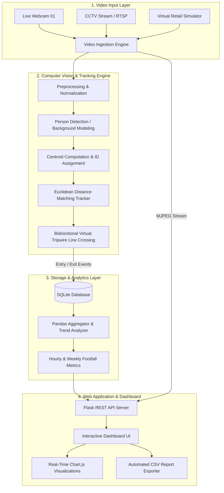

# AI Footfall — Smart Customer Analytics System
> **An Intelligent Computer Vision & Data Science Final Project for Retail Footfall Detection, Directional Tracking, and Real-Time Business Analytics.**

[](https://python.org)
[](https://opencv.org)
[](https://flask.palletsprojects.com/)
[](https://sqlite.org)
[](LICENSE)

---

## 📌 Executive Summary / Project Overview

Retail stores, shopping malls, supermarkets, and smart buildings require accurate, real-time insights into customer traffic to optimize staffing, evaluate marketing campaigns, manage store capacity, and improve sales conversion rates. Traditional manual counting or infrared beam counters suffer from high error rates, lack directional awareness, and provide no visual audit trail.

**AI Footfall** is an automated, end-to-end Computer Vision and Data Analytics solution that:
1. **Detects** pedestrians passing through entry and exit corridors using real-time video feeds.
2. **Tracks** individual pedestrians across consecutive frames using Euclidean distance centroid tracking with unique ID assignment and motion trajectory vectors.
3. **Counts** customers crossing virtual bidirectional tripwire lines (differentiating **Entered** vs **Exited**).
4. **Calculates** live store occupancy, peak hours, busiest days, and conversion rates.
5. **Visualizes** live metrics and historical trends on an interactive executive dashboard with Chart.js, real-time MJPEG camera streaming, and automated CSV report generation.

---

## 🏗️ System Architecture



---

## 🧮 Mathematical Formulation & Methodology

### 1. Centroid Calculation
For a detected bounding box $B_i = (x_{min}, y_{min}, x_{max}, y_{max})$, the spatial center $(\bar{x}, \bar{y})$ is computed as:
$$\bar{x} = \frac{x_{min} + x_{max}}{2}, \quad \bar{y} = \frac{y_{min} + y_{max}}{2}$$

### 2. Euclidean Distance Association
Given existing tracked object centroids $O = \{c_1, c_2, \dots, c_N\}$ and newly detected centroids $D = \{p_1, p_2, \dots, p_M\}$, the association matrix $D_{ij}$ is formed by computing the pairwise Euclidean distance:
$$d(c_i, p_j) = \sqrt{(c_{i,x} - p_{j,x})^2 + (c_{i,y} - p_{j,y})^2}$$
An optimal greedy bipartite matching assigns the minimum distance pair $(i, j)$ subject to the gating threshold:
$$d(c_i, p_j) \le D_{max}$$
Centroids exceeding $D_{max}$ trigger a new object ID registration. Objects unobserved for $N_{disappeared} > 30$ frames are deregistered to conserve memory.

### 3. Virtual Tripwire Line-Crossing Logic
Let the virtual counting tripwire be positioned at horizontal line $y = Y_{line}$. For an object $k$ with previous position $(x_{t-1}, y_{t-1})$ and current position $(x_t, y_t)$:
- **Customer Entered**:
  $$y_{t-1} < Y_{line} \quad \text{and} \quad y_t \ge Y_{line}$$
- **Customer Exited**:
  $$y_{t-1} > Y_{line} \quad \text{and} \quad y_t \le Y_{line}$$

### 4. Real-Time Occupancy Calculation
$$\text{Occupancy}(t) = \max\left(0, \sum \text{Entered}(t) - \sum \text{Exited}(t)\right)$$

---

## 📂 Project Directory Structure

```text
ai-footfall-counter/
├── app.py                # Flask Web Server & REST API endpoints
├── detector.py           # Computer Vision pipeline & virtual simulation generator
├── tracker.py            # Euclidean Centroid Tracker & tripwire crossing algorithm
├── database.py           # SQLite database layer, trend calculations & CSV export
├── test_system.py        # Automated test verification suite
├── requirements.txt      # Python dependencies
├── run.bat               # 1-Click launcher for Windows
├── run.sh                # 1-Click launcher for Linux/macOS
├── footfall.db           # SQLite database (auto-generated)
├── templates/
│   ├── index.html        # Responsive analytics dashboard (HTML5, CSS3, Chart.js)
│   └── mobile.html       # Mobile phone camera live streamer UI
├── README.md             # Project documentation & quickstart guide
└── PROJECT_REPORT.md     # Full academic project report & Viva Voce Q&A
```

---

## 🚀 Quickstart & Installation

### Step 1: Prerequisites
Ensure Python 3.10+ is installed on your system.

### Step 2: Install Dependencies
Open your terminal inside the project directory:
```bash
pip install -r requirements.txt
```

### Step 3: Run the Verification Suite
Confirm all modules and endpoints function properly:
```bash
python test_system.py
```

### Step 4: Launch the Application
- **Windows**: Double-click `run.bat` or run:
  ```bash
  python app.py
  ```
- **Linux/macOS**:
  ```bash
  chmod +x run.sh && ./run.sh
  ```

### Step 5: Open the Web Dashboard
Open your web browser and navigate to:
```
http://localhost:5000/
```

---

## 🎛️ Modes of Operation

### 1. Virtual Simulation Mode (Default)
- **Zero Configuration**: Runs immediately on any computer without needing an external video file or webcam.
- Generates a photorealistic retail entrance hallway with pedestrian avatars, natural walking physics, varying clothing colors, bounding boxes, centroid trails, and live entrance/exit counting.

### 2. Live Webcam Mode
- To switch to your physical webcam directly from the dashboard:
  1. Go to the **AI Camera** or **Settings** tab.
  2. Select **"Mode: Live Webcam (OpenCV)"**.
- Or start directly from the command line:
  ```bash
  python app.py --mode webcam --camera 0
  ```

---

## 📡 REST API Reference

| Endpoint | Method | Description |
| :--- | :---: | :--- |
| `/` | `GET` | Main responsive dashboard interface |
| `/video_feed` | `GET` | MJPEG real-time video stream |
| `/api/stats` | `GET` | Current footfall stats, occupancy, FPS, and chart data |
| `/api/pause` | `POST` | Pause or resume video processing |
| `/api/reset` | `POST` | Reset live counters to baseline |
| `/api/report?type=<type>` | `GET` | JSON report data (Daily, Weekly, Monthly, Entry/Exit) |
| `/api/report.csv?type=<type>` | `GET` | Downloadable CSV report |
| `/api/mode` | `POST` | Switch between `simulation` and `webcam` |

---

## 🎯 Key Dashboard Features

- **Executive KPI Cards**: Real-time counter for Total Customers, Customers Entered, Customers Exited, and Current Occupancy.
- **Hourly Traffic Distribution**: Smooth interactive Chart.js line chart depicting peak footfall times.
- **Entry vs Exit Movement**: Doughnut chart contrasting store arrivals against departures.
- **Weekly Trend**: Bar chart tracking footfall from Monday through Sunday.
- **Occupancy Trend**: Real-time store capacity utilization monitoring against safety thresholds.
- **Automated Reporting Center**: On-demand generation and instant CSV export for daily, weekly, and shift audits.
- **Dark / Light Theme Toggle**: Ergonomic high-contrast dark theme and clean daytime theme.
